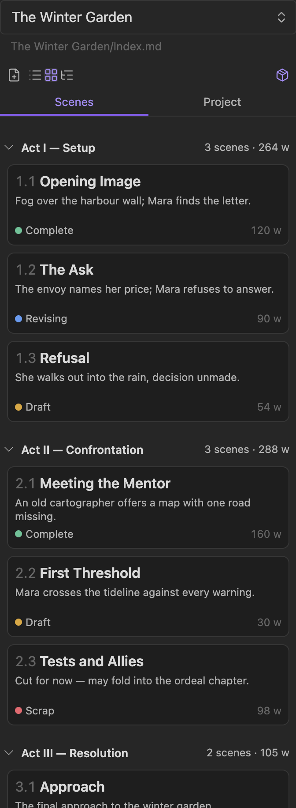
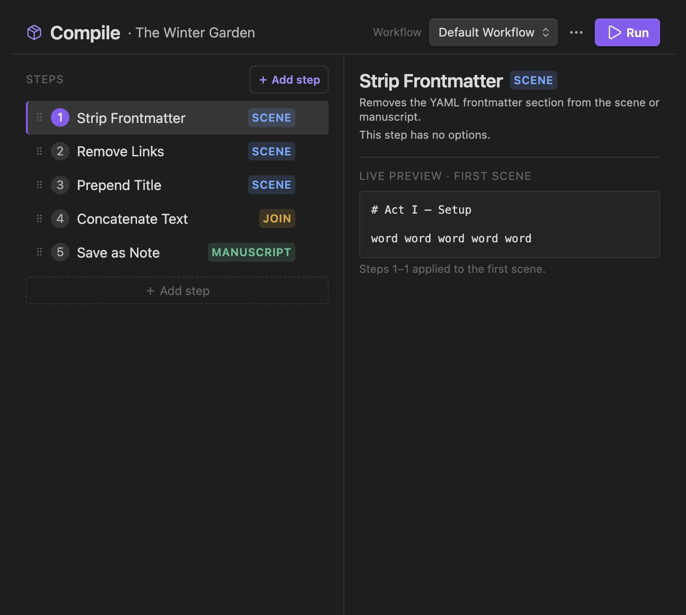

# Inkwell

An Obsidian plugin for writing novels, screenplays, and other long-form projects.

Inkwell began as a personal fork of [kevboh/longform](https://github.com/kevboh/longform) and has since diverged into its own project. Upstream Longform is no longer actively maintained, so Inkwell continues independently — with a **ground-up UI reimplementation**, a rebuilt toolchain, and a rethought way of storing project metadata in your vault, primarily to:

- make `Index.md` frontmatter safe to round-trip through Obsidian's Properties UI without nuking your project, and
- treat eBook / Dublin Core metadata as a first-class part of the project — no separate sidecar files.

This is a personal project, built to scratch my own writing setup and maintained for an audience of one. You're welcome to use it as-is, but I'm not accepting feature requests or PRs, and there's no roadmap, no support promises, and no guarantee of stability across releases.

> [!CAUTION]
> Inkwell uses an `Index.md` frontmatter schema that is **incompatible** with upstream Longform's. There is **no automated migration**. Projects authored against upstream Longform need a one-time hand-edit. See [Migrating](#migrating) below.

## What it does

- **Organise a manuscript.** Create a multi-scene project or a single-note project. List, Cards, and Outline show the order and nesting from `Index.md`, with scene titles, status, and word counts. Cards also show the subtitle and summary when present.
- **Track the story.** Edit chapter metadata, POV, cast, locations, and timing in the tabbed **Scene details** dialog. The **Codex** links to ordinary Markdown character and location notes and lists their scenes in manuscript order.
- **See when things happen.** Open **Timeline** from the Scenes view menu and choose **Manuscript order**, **Story order**, or **Start date**. Filter by character or location.
- **Start chapters with a preset.** The vault-wide Chapter preset adds editable YAML defaults and fills the title when you create a scene. [Chapter preset guide](./docs/interface.md#chapter-preset)
- **Compile the manuscript.** Open the Compile builder at the bottom of **Project** on desktop. Configure reusable workflows and preview scene steps before running them. eBook metadata lives in the project frontmatter for compile steps to use. [Compile builder guide](./docs/interface.md#the-compile-builder)

Because Inkwell uses its own plugin id (`inkwell`), it can be installed alongside upstream Longform without conflict.

## A redesigned interface

The UI Inkwell inherited from Longform worked but had never had a design pass. `2.0.0` rebuilt nearly every surface — driven by a written usability [audit](./docs/ui-audit/README.md) and [mockups](./docs/ui-audit/mockups/MOCKUPS.md), both kept in the repo.

<table>
  <tr>
    <td width="34%" valign="top"></td>
    <td width="66%" valign="top"></td>
  </tr>
  <tr>
    <td valign="top"><b>Scenes</b> — manuscript views with colour-coded status, per-scene word counts, and collapsible acts.</td>
    <td valign="top"><b>Compile</b> — a full-pane builder: one-line steps with colour-coded kinds on the left, config + live preview on the right, Run always in reach.</td>
  </tr>
</table>

There's also a lean Project tab, a wide **eBook metadata modal**, and an action-first **New Project** modal.

- **[Interface guide](./docs/interface.md)** — a walkthrough of every surface.
- **[The UI redesign](./docs/ui-redesign.md)** — the full before/after.

## Schema vs. upstream Longform `2.x`

| Area | Upstream Longform `2.x` | Inkwell |
|---|---|---|
| Discriminator | Nested `longform:` object with `format:` inside | Top-level `inkwell: scenes` or `inkwell: single` |
| Project keys | Nested under `longform.*` | Flat properties such as `title`, `workflow`, `sceneFolder`, `codexFolder`, `scenes`, and `ignoredFiles` |
| Scene hierarchy | Nested YAML arrays (`- - second scene`) | Flat array with `> ` prefix tokens (`"> second scene"`) — round-trips safely through Obsidian's Properties UI |
| eBook metadata | Stored separately by the writer | Top-level keys such as `author`, `language`, `identifier`, `cover`, and `subjects`, edited through the **eBook metadata** button in Project |
| Scene display label | Filename only | `frontmatter.title` of each scene file, falling back to filename |
| Migration | Plugin runs a migration on first launch | **None.** Files using the legacy nested form are silently ignored. |

## Migrating

**From upstream Longform `2.x`:** open each `Index.md` and rewrite the frontmatter.

**Before** (upstream Longform `2.x`):

```yaml
---
longform:
  format: scenes
  title: My Novel
  workflow: Default Workflow
  sceneFolder: /
  scenes:
    - first scene
    - - second scene
      - third scene
    - fourth
  ignoredFiles:
    - "*-scratch"
---
```

**After** (Inkwell):

```yaml
---
inkwell: scenes
title: My Novel
workflow: Default Workflow
sceneFolder: /
scenes:
  - first scene
  - "> second scene"
  - "> third scene"
  - fourth
ignoredFiles:
  - "*-scratch"
---
```

Each nested array level in `scenes:` becomes one `> ` token. Save the file and the project reappears in the Inkwell pane. eBook fields are optional and can be added later through the Project tab UI.

If you're coming from Longform, also move its data folder, which Inkwell relocated from `<vault>/.obsidian/longform/` to `<vault>/.obsidian/inkwell/` — move your `workflows.json` and any user compile-step scripts there.

## Installing

Not in the Community Plugins store. Two ways to install:

### Via BRAT (recommended)

[BRAT](https://github.com/TfTHacker/obsidian42-brat) installs plugins directly from GitHub releases and keeps them auto-updated:

1. Install **BRAT** from Obsidian's Community Plugins and enable it.
2. Run the command **"BRAT: Add a beta plugin for testing"**.
3. Enter `delfianto/inkwell` and confirm.

BRAT pulls the release assets into `.obsidian/plugins/inkwell/`, enables the plugin, and checks for new releases automatically.

### Manual

1. Download `manifest.json`, `main.js`, and `styles.css` from a [release](https://github.com/delfianto/inkwell/releases).
2. Drop them into `.obsidian/plugins/inkwell/` inside your vault.
3. Enable **Inkwell** in Obsidian's Community Plugins settings.

## Getting started

1. In **Settings → Inkwell**, set **Writing projects folder** to choose the default destination for new projects. The project picker discovers projects throughout the vault.
2. Use **New project** in the Inkwell sidebar. Choose a project type and title. **Change folder** sets the destination for this project.
3. In a multi-scene project, use **New scene** in the sidebar. For structured chapter notes, first choose **Settings → Inkwell → Scene template → Use Chapter preset**. Use the edit button to customise `Templates/Inkwell Chapter.md`. A selected vault-wide template takes precedence over an older project's template setting.
4. Create character and location notes in **Codex**, open a scene, and link its cast and locations in **Scene details**. Use the **Timing** tab to place it on the Timeline.

For screenshots and step-by-step controls, see the [Interface guide](./docs/interface.md).

### Vault layout

With `Writing/` selected as the writing projects folder, a new multi-scene project called *StoryA* uses this layout. Inkwell creates the chapter preset in the vault-level `Templates/` folder when enabled.

```text
Templates/
  Inkwell Chapter.md
Writing/
  StoryA/
    Index.md
    Scenes/
    Codex/
      Assets/
      Characters/
      Locations/
      Timeline/
```

**Project → Scene folder** and **Codex folder** resolve from the directory containing `Index.md`. New indexes store `sceneFolder: Scenes` and `codexFolder: ./Codex`. The leading `./` identifies a project-relative Codex path. Inkwell also reads older vault-relative Codex paths, and a scene folder of `/` refers to the project directory itself.

### What lives in YAML

`Index.md` records which scenes belong to the manuscript, their order and nesting, the project folders, eBook metadata, and the compile workflow. Scene-specific properties live in each scene note. The Timeline sorts by `start` in calendar order and shows `finish` when present. Manual story order uses `storyOrder`. The `pov` field holds the narrative style, and `povCharacter`, `characters`, and `locations` link to Codex notes.

The `Codex/Timeline/` directory is available for reference notes. The current Timeline view displays indexed scenes. Compile reads manuscript order from `Index.md`.

## Stack

| Layer | Tool |
|---|---|
| Runtime / package manager | Bun, pinned in `.tool-versions` |
| Build / lint / format / test | Vite+ through the scripts in `package.json` |
| UI framework | Svelte 5 (runes mode) |
| Type-checking | TypeScript 6, using `tsc --noEmit` and `svelte-check` |

`vite` is aliased to `@voidzero-dev/vite-plus-core`. The test suite imports from `vite-plus/test` and runs with `vp test run`.

## Development

```sh
bun install --frozen-lockfile
bun run check        # format check and lint
bun run type-check   # TypeScript and Svelte
bun run test
bun run build        # production build in dist/
bun run dev          # watch build into an Obsidian plugin directory
```

`bun run build` writes `main.js`, `styles.css`, and `manifest.json` to `dist/`. Use those files for a manual install or symlink the `dist/` directory to your vault's `.obsidian/plugins/inkwell/`.

Watch mode writes to `test-vault-inkwell/.obsidian/plugins/inkwell/` by default. Set `PLUGINS_DIR` to a vault's `.obsidian/plugins/` directory to build directly there. [Environment example](./.envrc.example) · [Repository guide](./AGENTS.md)

## Scene-only styling

Inkwell attaches the `.inkwell-leaf` CSS class to any pane editing a scene or index file. This lets you style your writing environment independently of the rest of Obsidian. Upstream's [Scene-only Styling](https://github.com/kevboh/longform#scene-only-styling) section has a working example (adapt the class name to `.inkwell-leaf`).

## Troubleshooting

> [!IMPORTANT]
> **Scene details** saves the story properties you edit in a scene's frontmatter. Scene prose and other properties are preserved.

If a project disappears from the sidebar after you edit its `Index.md`, the frontmatter no longer matches the schema — most often a missing top-level `inkwell: scenes` (or `single`). Either fix it by hand or restart Obsidian. Inkwell recomputes projects from frontmatter on each load and never deletes files based on frontmatter state.

## License

Inkwell's own code is released under the [MIT License](./LICENSE). Portions inherited from upstream [Longform](https://github.com/kevboh/longform) remain under their original license, preserved in [LICENSE-longform.md](./LICENSE-longform.md). See [NOTICE](./NOTICE) for the full provenance.

## Credits

Inkwell stands entirely on [kevboh's](https://github.com/kevboh) original [Longform](https://github.com/kevboh/longform). The plugin architecture, compile pipeline, scene/draft model, and most of what makes it useful were all there before I touched it; the `2.0.0` redesign restyles and re-lays-out those surfaces, but the engine underneath is Longform's. The community [collection of compile steps](https://github.com/obsidian-community/longform-compile-steps) continues to apply — the compile step API is unchanged.
