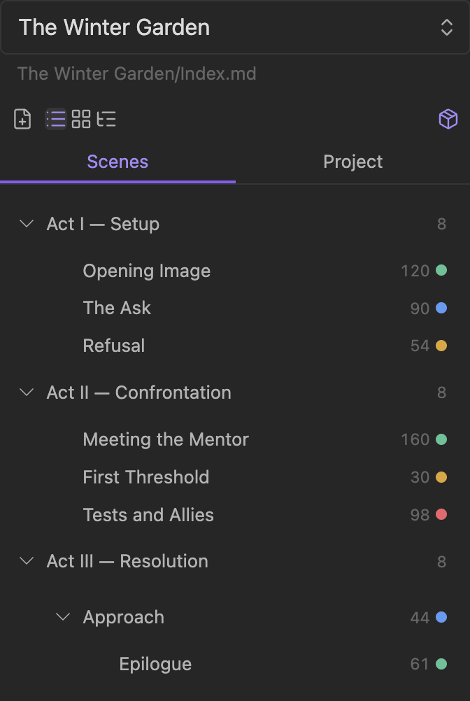
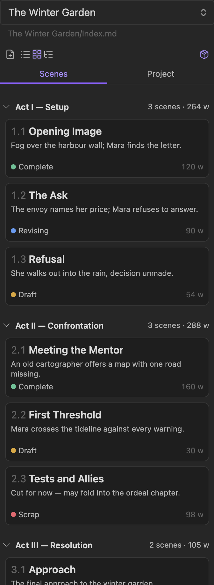
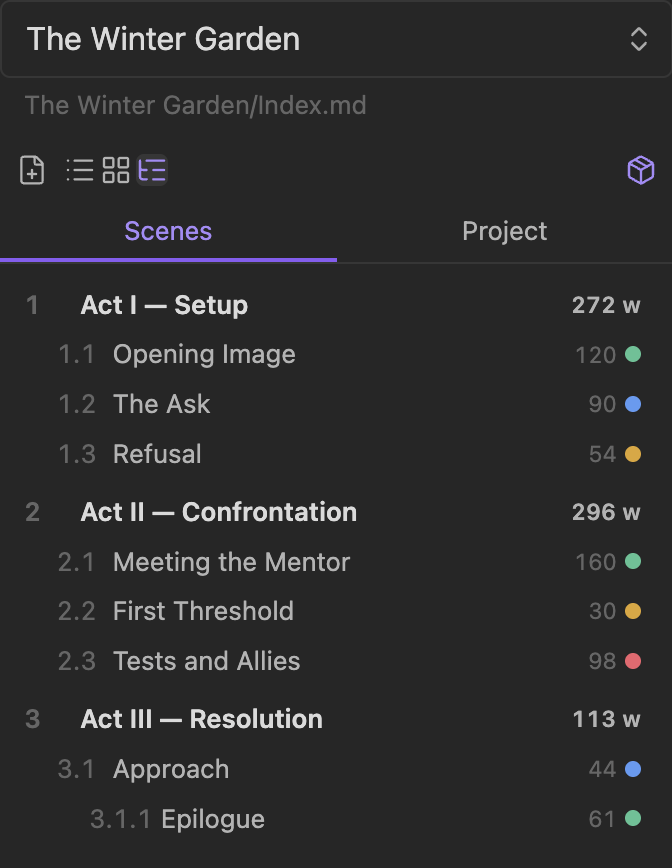
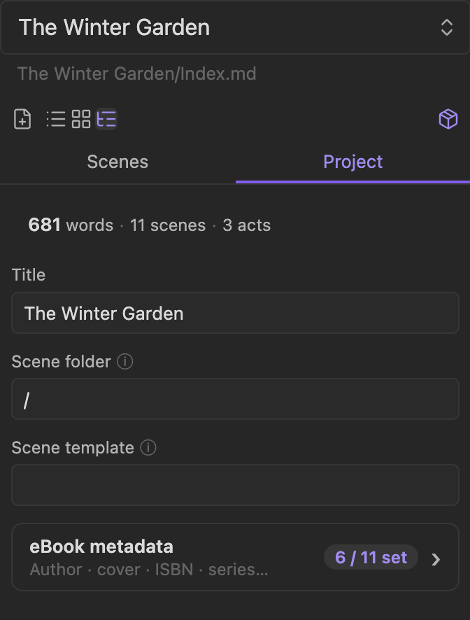
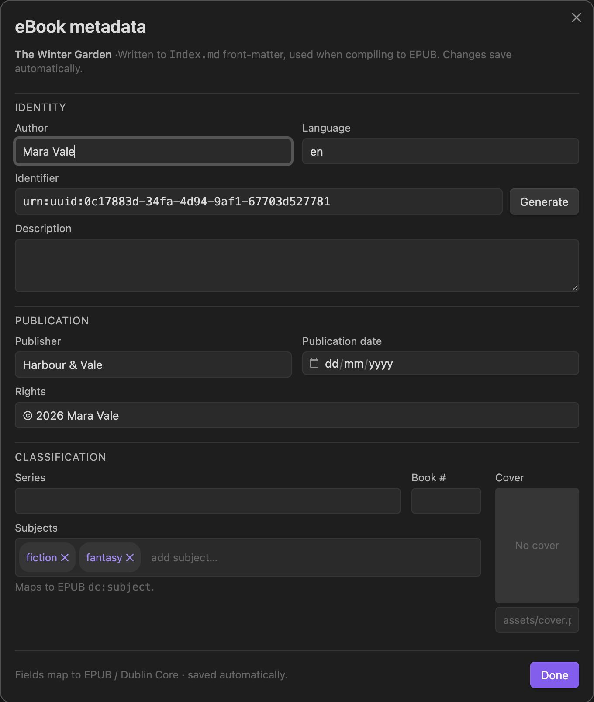
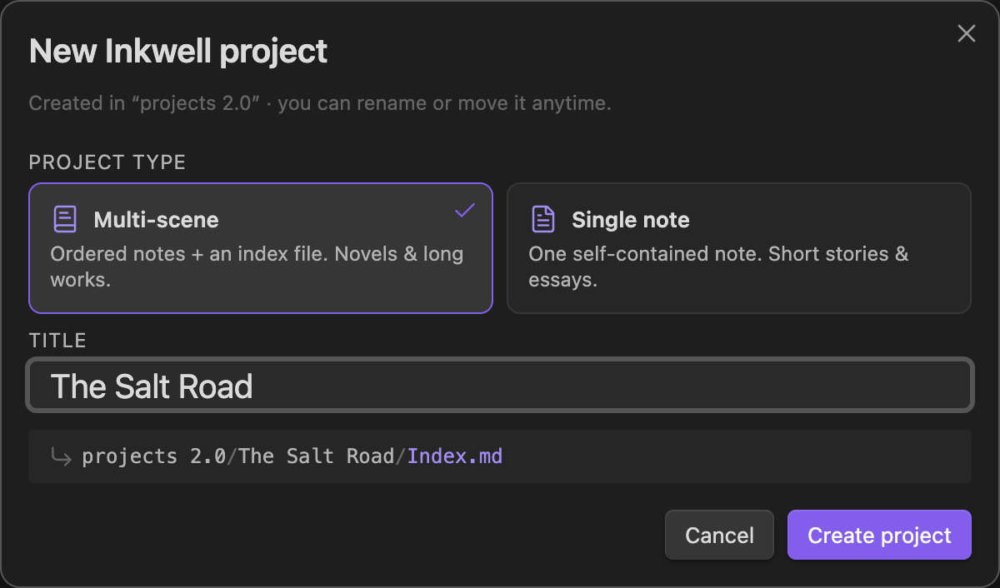
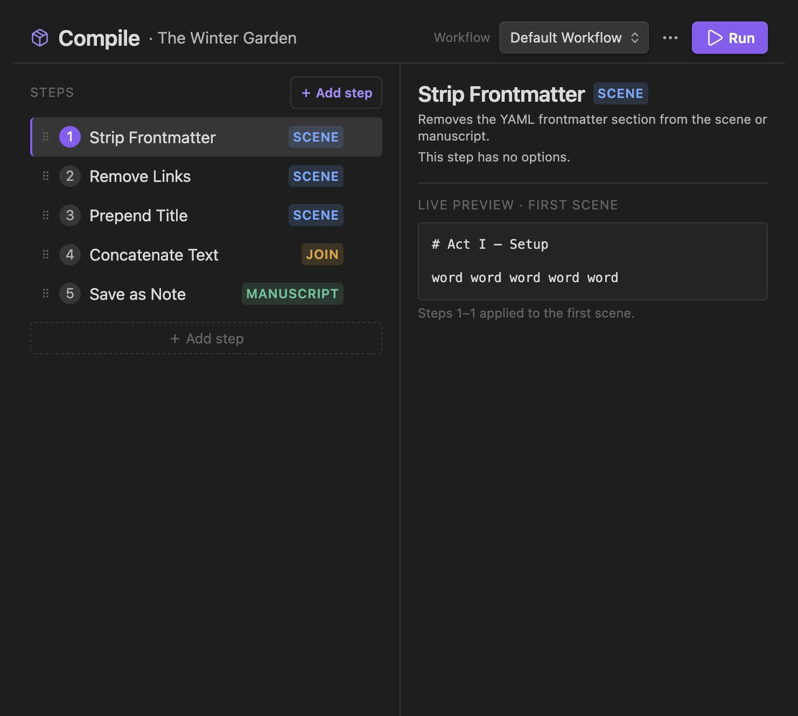

# Interface guide

Inkwell lives in a single sidebar pane plus a full-pane **Compile builder**. This
page walks through every surface. Inkwell rides Obsidian's theme variables, so
everything below adapts to your theme and accent colour — the screenshots use the
default dark theme.

> New to the on-disk format? The `Index.md` frontmatter schema is covered in the
> [main README](../README.md#schema-vs-upstream-longform-2x). This guide is about
> the UI. For the story behind the redesign, see [The UI redesign](./ui-redesign.md).

## Contents

- [The sidebar at a glance](#the-sidebar-at-a-glance)
- [Scene views](#scene-views)
- [Chapter preset](#chapter-preset)
- [Codex and scene details](#codex-and-scene-details)
- [Timeline](#timeline)
- [Scene status colours](#scene-status-colours)
- [The Project tab](#the-project-tab)
- [eBook metadata modal](#ebook-metadata-modal)
- [Creating a project](#creating-a-project)
- [The Compile builder](#the-compile-builder)

## The sidebar at a glance

Every project surface hangs off one pane. From top to bottom:

1. **Project picker** — a dropdown of every Inkwell project in the vault, with the
   selected project's `Index.md` path shown beneath it.
2. **Scenes / Codex / Project tabs** — pick the part of your project you want to work in.
3. **Scenes toolbar** — the scene-view button, **Scene details**, and **New scene**.

A single-note project shows the Project fields directly. **Open Compile builder**
is below the Project controls on desktop.

## Scene views

The Scenes tab offers **List**, **Cards**, **Outline**, and **Timeline** in one
menu and remembers your choice. The first three show the manuscript hierarchy with the same
data: scene order and nesting from `Index.md`, the display title from each scene's
`frontmatter.title` (falling back to the filename), the word count from Inkwell's
tracker, and the status from each scene's `status:` frontmatter.

Scenes are grouped into **Acts** — every top-level (un-indented) scene starts a new
act, and the scenes nested under it become its members.

| List — the default | Cards — visual, wide | Outline — full depth |
|---|---|---|
|  |  |  |
| Compact rows with a status dot and word count. Collapsible act headers show a scene count. | Each scene is a card with its number, title, a synopsis line, a status label, and its word count. Acts are collapsible with per-act word subtotals. | An indented tree with hierarchical numbering (`1`, `1.1`, `3.1.1`), status dots, word counts, and rolled-up act totals — the view for deeply nested work. |

Cards and Outline cap the visible nesting at two levels for scannability (Outline
still shows deeper numbering). **New scene** (the toolbar's file-plus icon) opens an
inline input at the top of the list; press Escape or blur it empty to dismiss.

### Reordering

Scene rows are drag-to-reorder and drag-to-nest. A grab handle appears on hover so
the interaction is discoverable — drag a row up/down to reorder, or right/left to
change its nesting (which act it belongs to).

## Chapter preset

Open **Settings → Inkwell → Scene template → Use Chapter preset**.
Inkwell sets up a shared Markdown template at `Templates/Inkwell Chapter.md`
from the vault root. The edit button opens it so you can change defaults such
as status, POV style, and tags.

Use **New scene**, enter a title, and select **Create**. Inkwell copies the
preset's properties and note body, fills the title, and stamps `updated` if
the template includes that property. The Chapter preset works with Obsidian's
templating plugins disabled. Choose a custom template from the vault's
`Templates/` folder to use the existing Templater or core Templates workflow.
When a global template is selected it is used for new scenes across projects.
An older project's configured template is used when the global setting is clear.

## Codex and scene details

Open **Scene details** from the Scenes toolbar while a scene is active.

| Tab | What you edit |
|---|---|
| **Chapter** | Title, subtitle, arc, chapter number, Draft or Complete status, summary, and context |
| **People & places** | POV style, POV character, cast, and locations |
| **Timing** | Start, finish, weekday, manual story order, and a free-text time label |
| **Properties** | Mood, tags, and version |

Add mood values and tags with **Add** or Enter. **Save changes** saves edits
across all tabs, including any mood value or tag still in the input, and
refreshes `updated` on notes that include it. Closing the dialog with pending
edits asks whether to discard them. When the form has no pending edits, the
arrows beside the scene title load the previous or next scene's properties in
manuscript order. The dialog stays on the same tab and keeps the active note in
place. **Save changes** updates the scene shown in the dialog and closes it.
Use Obsidian Properties for fields outside this dialog.

Choose **Codex → Characters** or **Locations** to browse your reference notes
or create one. Pick an entry to see its scenes in manuscript order, or select
**Open note** to edit its Markdown.

From **Scenes**, open a scene and choose **Scene details → People & places**.
Use the note pickers to set its point of view, cast, and locations, then save.
Reopen Scene details and click an assigned name to jump to its Codex entry.
Each scene appears once per entry even when a character is assigned as both
POV and cast.

New projects have a `Codex/` folder beside the index with `Assets/`,
`Locations/`, `Characters/`, and `Timeline/` subfolders.
**Project → Codex folder** takes a path relative to the project directory.
Drafts can share a Codex by entering a relative path such as `../Shared Codex`.
Each draft lists appearances from its own manuscript.

## Timeline

Choose **Timeline** in the Scenes view menu. The order button shows the active
sort. **Manuscript order** follows your project index, **Story order** uses
the manual number from Scene details, and **Start date** uses `start` and
displays the range through `finish` when set. Entering a start date in Scene
details also fills the weekday. Ties follow manuscript order, and scenes
missing the chosen sort value appear under **Unplaced**.

Use **Filter** to search for a character or location and see the scenes that
link to it. The selected name appears below the controls. Use the **×** beside
it to show all scenes again.

The Timeline reads the YAML of scenes in the project index. The
`Codex/Timeline/` folder is available for separate story reference notes.
Compiling follows manuscript order.

## Scene status colours

Choose **Draft** or **Complete** in **Scene details → Chapter**. Inkwell saves
the choice to `status` in the scene's frontmatter and displays a colour-coded
dot and label. Existing status values stay in place until you choose a new
status. Older values such as `revising` and `scrap` keep their colours.

| `status:` | Colour | Meaning |
|---|---|---|
| `draft` | 🟡 amber | first pass |
| `revising` | 🔵 blue | being revised |
| `complete` | 🟢 green | done |
| `scrap` | 🔴 red | cut / parked |

```yaml
---
title: Opening Image
status: complete
---
```

Any other value gets a neutral dot. The colours are plain CSS custom properties
(`--inkwell-status-*`) declared at `:root`, so you can override them in a vault
snippet. Status is first-class now — no snippet required to see it.

## The Project tab

The Project tab is deliberately lean: a one-line overview and the essentials.



- **Overview** — `words · scenes · acts` for the whole project.
- **Title**, **Scene folder**, and **Codex folder** are the core fields. Both
  folder paths are relative to the directory containing the project index. Longer
  explanations sit behind an ⓘ affordance instead of permanent paragraphs of faint
  help text.
- **eBook metadata launcher** — a card showing how many of the eleven eBook fields
  are set (`6 / 11 set`) that opens the metadata modal.
- **Open Compile builder** — the last control on desktop.

## eBook metadata modal

eBook / Dublin Core metadata is a first-class part of an Inkwell project. Rather
than stack eleven fields in the narrow sidebar, Inkwell edits them in a wide modal.



Fields are grouped into **Identity** (author, language, identifier, description),
**Publication** (publisher, publication date, rights), and **Classification**
(series, book number, subjects, cover):

- **Subjects** are entry chips — type and press Enter to add, click × to remove.
  They map to EPUB `dc:subject`.
- **Cover** shows a live thumbnail with a file picker.
- **Generate** creates a `urn:uuid:` identifier.

Everything **saves automatically** to `Index.md` frontmatter as you type — the
same top-level keys the compile step reads when producing an EPUB. There is no
sidecar file.

## Creating a project

Set **Settings → Inkwell → Writing projects folder** to give new projects a
default home. **New project** in the sidebar and the command **Inkwell: Create
new project** open the creation dialog with that folder selected. Use **Change
folder** in the dialog for a one-off destination. When the setting is clear,
Inkwell asks for a folder first.

You can also right-click a folder in Obsidian's file explorer and choose
**Create Inkwell Project** to start there. The project picker lists projects
across the vault.



Pick a **type** — Multi-scene (ordered notes + an index file) or Single note — as a
selectable card, type a **title**, and watch the **live path preview** update.
**Create project** is always visible (disabled until the title is valid).

A new multi-scene project has this structure under its chosen destination.

```text
StoryA/
  Index.md
  Scenes/
  Codex/
    Assets/
    Locations/
    Characters/
    Timeline/
```

In `Index.md`, `sceneFolder: Scenes` resolves beside the index. A local Codex
is written as `codexFolder: ./Codex`. The leading dot distinguishes the
project-relative path from an older vault-relative Codex setting.

## The Compile builder

Compile is a full workspace pane, not a cramped sidebar column. Open it from the
bottom of **Project** or the "Inkwell: Open compile builder" command.



- **Top bar** — the project name, a workflow picker, an overflow menu, and **Run**
  (always reachable).
- **Steps (left)** — one compact row per step: ordinal, name, a **colour-coded kind
  pill** (Scene = blue, Join = amber, Manuscript = green), a drag handle, and remove.
  Select a row to configure it.
- **Config (right)** — options for the *selected* step only, so a long workflow no
  longer means an endless scroll.
- **Live preview** — the selected step (and the Scene-kind steps before it) applied
  to your first scene, so you can see the effect before running. Steps with side
  effects (Join / Manuscript / Save) are never executed for the preview.
- **Status bar** — validity and a step breakdown (`5 steps · Scene ×3 · Join ×1 ·
  Manuscript ×1`).

The compile-step API is unchanged from Longform, so the community
[collection of compile steps](https://github.com/obsidian-community/longform-compile-steps)
still applies.
